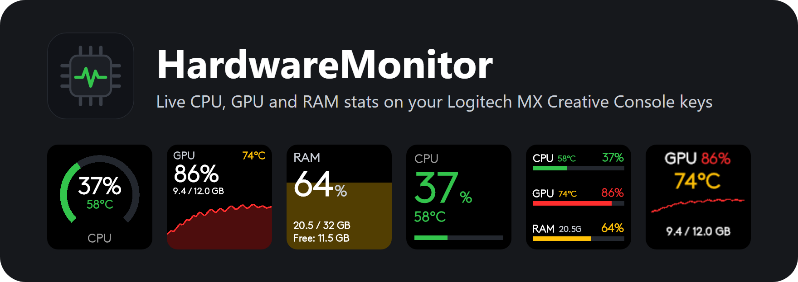
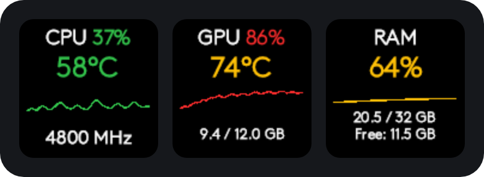
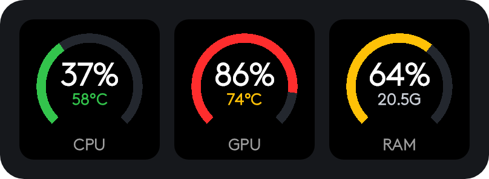
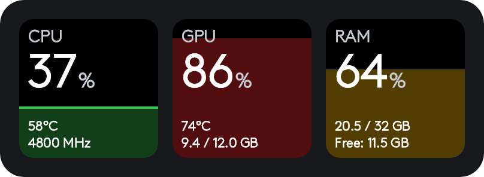
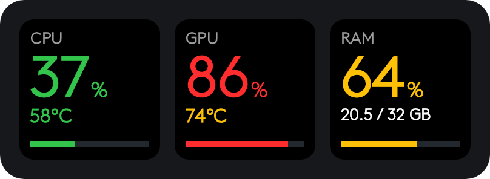
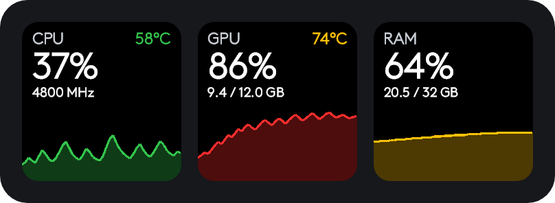
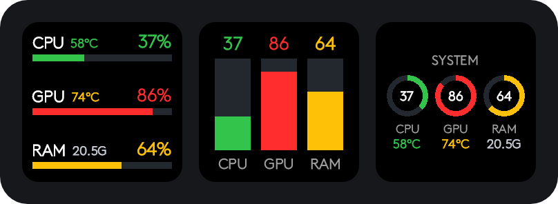

<p align="center">
  
</p>

<p align="center">
  <a href="https://github.com/GavryschukOleg/HardwareMonitor/releases"></a>
  <a href="LICENSE"></a>
  
  <a href="https://paypal.me/donicteck"></a>
</p>

# HardwareMonitor

A plugin for the **Logitech MX Creative Console** (and other Logi Plugin Service devices) that puts live **CPU, GPU and RAM** stats on the device keys. The numbers come from [LibreHardwareMonitor](https://github.com/LibreHardwareMonitor/LibreHardwareMonitor), so it works with AMD and Intel CPUs and with NVIDIA, AMD and Intel GPUs.

I built it for myself: I wanted the key system stats always in front of me, and nothing on the marketplace fit in either function or looks. So I wrote my own, with the help of AI.

## Features

- **CPU**: load, temperature, clock speed
- **GPU**: load, temperature, VRAM used / total
- **RAM**: load, used / total, free memory
- **18 actions in 6 card styles**: pick the look you like per key, or put all three metrics on one key
- **Color coded**: green, amber and red by load and temperature
- **Load history** graphs that keep recording even when the key is on another page
- Updates every 1.5 seconds with a single lightweight request, whatever the number of keys
- No vendor-specific setup: hardware is detected automatically

## Card styles

Every image below is the plugin's real output, not a mockup.

### Classic

Load, temperature, a load-history sparkline and a detail line. Actions: `CPU`, `GPU`, `RAM`.



### Ring

A gauge around the load, with temperature (or used memory) underneath. Easy to read from a distance. Actions: `CPU · Ring`, `GPU · Ring`, `RAM · Ring`.



### Fill

The key fills up like a tank as the load rises, so you can read it without looking at the digits. Actions: `CPU · Fill`, `GPU · Fill`, `RAM · Fill`.



### Big number

One large value, a second value below it and a thin progress bar. Actions: `CPU · Big number`, `GPU · Big number`, `RAM · Big number`.



### Graph

The load history takes the lower half of the key, with the numbers above it. Actions: `CPU · Graph`, `GPU · Graph`, `RAM · Graph`.



### System

CPU, GPU and RAM together on a single key, for when keys are scarce. Actions: `System · Bars`, `System · Columns`, `System · Rings`.



### Colors

| Color | Load / temperature |
|---|---|
| Green | below 60 |
| Amber | 60 to 84 |
| Red | 85 and above |

Load is measured in percent and temperature in °C; both use the same thresholds.

## Requirements

- Windows 10 or 11
- Logitech MX Creative Console, or another device supported by Logi Plugin Service (Loupedeck CT / Live / Live S, Razer Stream Controller)
- [Logi Options+](https://www.logitech.com/software/logi-options-plus.html) with Logi Plugin Service
- [LibreHardwareMonitor](https://github.com/LibreHardwareMonitor/LibreHardwareMonitor) running with its web server enabled

The plugin was developed and tested on the MX Creative Console (116 px keys). The Classic style is laid out for keys of that size; on devices with smaller keys, prefer the other styles.

## Installation

1. Download the latest `.lplug4` file from the [Releases](https://github.com/GavryschukOleg/HardwareMonitor/releases) page.
2. Double-click the file. Logi Plugin Service installs the plugin.
3. Set up LibreHardwareMonitor (see below).
4. In Logi Options+, open your device, find the **Hardware Monitor** group and drag the actions you want onto the keys.

From the command line:

```powershell
logiplugintool install ./HardwareMonitor.lplug4
```

### Setting up LibreHardwareMonitor

1. Run LibreHardwareMonitor **as administrator**. Without it, most CPU temperature and clock sensors are not available.
2. Turn on the web server: **Options → Remote Web Server → Run**. Keep the default port, **8085**.
3. To have it ready after every reboot, enable **Options → Run On Windows Startup** and **Start Minimized**.

The plugin reads `http://127.0.0.1:8085/data.json` from your own machine. Nothing is sent anywhere else.

## Troubleshooting

| What you see | What to check |
|---|---|
| Keys show **Offline / No connection** | LibreHardwareMonitor is not running, or its web server is off or on a port other than 8085. Opening `http://127.0.0.1:8085` in a browser should show the sensor tree. |
| Temperature or clock shows `--` | LibreHardwareMonitor is not running as administrator, or your hardware does not expose that sensor. |
| The wrong GPU is shown | With several GPUs, the plugin shows the one with the highest load at the moment. |
| New actions are missing in Logi Options+ | Restart Logi Options+ so it reloads the plugin's action list. |

Found a bug or want another style? [Open an issue](https://github.com/GavryschukOleg/HardwareMonitor/issues).

## Building from source

Requires the Logi Plugin Service (it provides `PluginApi.dll`), the .NET 10 SDK and [LogiPluginTool](https://logitech.github.io/actions-sdk-docs/).

```powershell
dotnet build -c Release
logiplugintool pack ./bin/Release ./HardwareMonitor.lplug4
logiplugintool verify ./HardwareMonitor.lplug4
```

Build from the repository root. A Debug build also links the plugin into a running Logi Plugin Service and reloads it, so you can see changes on the device straight away.

## Support the project

If the plugin is useful to you, a coffee is always welcome. A star on the repository helps too.

<a href="https://paypal.me/donicteck"></a>

## License

[MIT](LICENSE)
